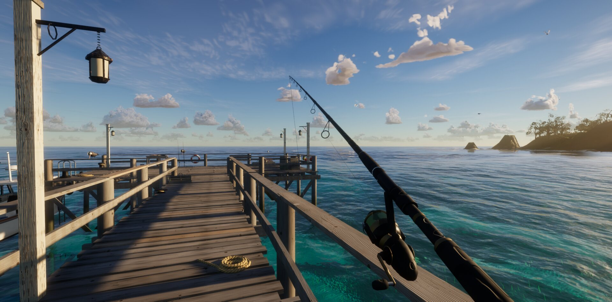
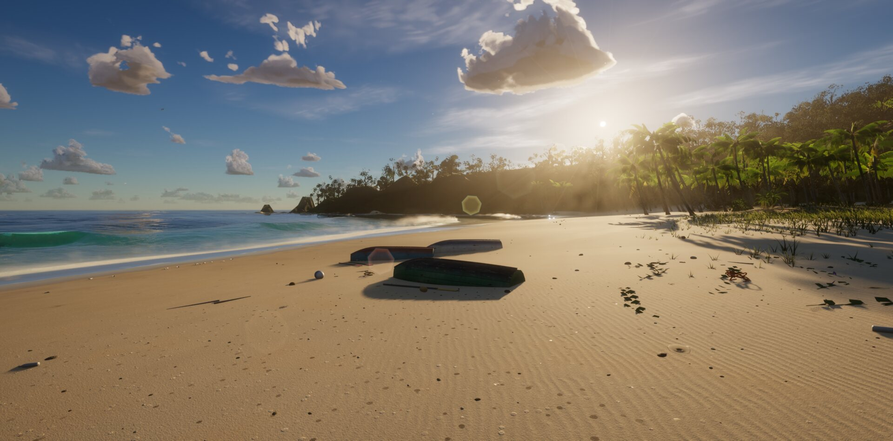

# STORMWAKE V66 · 深渊船员协作

本轮更新：先读 [README_V66.md](README_V66.md)，双击 `00_START_V66.cmd`。详细方案和验收见 [V66 设计](docs/V66_DESIGN.md) 与 [V66 验收](docs/V66_ACCEPTANCE.md)。

---

# STORMWAKE V64 · 航行物理与船舱通行修复

当前版本请先阅读 [README_V64_先读我.md](README_V64_先读我.md)，双击 `00_START_V64.cmd` 启动。本轮修复与实际证据见 [V64 修复与验收](docs/V64_FIXES_AND_ACCEPTANCE.md)。旧梯子快捷键、辅机和人物朝向说明已被 V64 替代。全部扩展细节仍在持续验收，未宣称整个设计文档已完成或零缺陷。

以下保留历史 V44 说明，描述的是当时版本。

---

# STORMWAKE V44 P1 · 远洋天气、龙卷、十舰幽灵海战、舱底存取（阶段工程）

**这是对 V43 完整源码的第一阶段真实改造，不是整套 V44 已全部完工的最终版。** 默认仍使用原有 8.2m 小船；可完整自由进入、拥有多层甲板的复古大船尚未替换。V44 P1 已增加远海实时天气/雨幕、真实物理水龙卷吸力、10 艘可被炮击击沉的绿色半透明幽灵舰（简化模型），及旧舱底宝箱的可见存取。

**运行（Python，无需 npm）：** Windows 双击 `START_STORMWAKE_V44_P1.cmd`，或运行 `python start_v44.py`；Edge/Chrome 打开 `http://127.0.0.1:5173/?stormwake=1`。`Z` 航海图选择海域 5（风暴）、6（幽灵舰队）或 7（龙卷）；**远海确实远离港口**，无自动传送。原有船舶基本操控保留。

**测试（装有 Node.js）：** `npm run test:v44` 执行 12 项 V44 专项与完整 V43 旧版回归。浏览器自动化本地访问受沙箱策略阻断，未声称 WebGPU 实机通过。**变更、局限与 P2/P3 工作清单：** `docs/V44_P1_第一阶段源码实施与验收报告.md`。

---

# STORMWAKE V43 · 船舱、船员与海战实装版（阶段交付）

**基于 V42 全部源码与资源修改**，不重写 WebGPU/WGSL、海洋与天空引擎，不引入《盗贼之海》专有内容。V43 是持续开发的船舶系统阶段版，**尚未实现设计手册的全部范围，尤其是三种独立航程、双手 IK 和完整登船战斗**。

**Windows 单机：** 解压后运行 `START_STORMWAKE_V43.cmd`；或 `python start_v43.py`，在 Chrome/Edge 打开 `http://127.0.0.1:5173/?stormwake=1`。请先关闭占用 5173 的旧版服务。局域网房主运行 `START_STORMWAKE_V43_COOP.cmd`（需要 Node.js 20+）。

**V43 重点：** 甲板靠近船舱口按 **E** 下入随船体摆动的低矮舱底，靠近梯口按 **E** 返回；水桶架按 E 取空桶、`2` 装备水桶，下舱按鼠标左键舀水、到船舷泼水；`6` 装备木板，靠近显示为焦黑圆孔的**实际破口**持续按左键 2.2 秒修补，个人木板有限，维修箱 `R` 领板也消耗船仓库存。船员可走到材料架取木板、下舱去破口；真实打炮要等后坐、装填进度，`R` 从有数量限制的炮弹库装填，链弹可损伤帆具。炮弹以实际重力轨迹命中，敌炮也走可躲避弹道，不再直接扣船血。

**保留的玩法：** 舵 `A/D` 调方向、`W/S` 控辅机，主/前帆 `W/S` 收放、`A/D` 调帆角，船锚 `E` 操作，`V` 切视角，`1` 刀、`3` 铲、`4` 灯、`5` 望远镜、`0` 收起，`G` 放下宝箱，金潮寻宝→搬运→入舱→回港出售的完整既有航程依旧可玩。

**审查：** `npm run test:v43`（或分别 `node test/stormwake-v43-core.mjs`、`node test/stormwake-v43-assets.mjs`）；`python tools/test_start_v38.py` 检查 HTTP 启动资源。请看 `docs/V43_源码实现与严格验收.md` 和 `docs/V43_授权资源实装清单.json`。**WebGPU 浏览器的真实画面与 Windows 交互体验尚未通过实机验收，不得视为商业级完工。**

---

# STORMWAKE V42 · 航程、工具与交互深度重构（完整游戏）

> V42 基于 V41 真正源码修改，维持原 WebGPU / WGSL 自研引擎；没有使用《盗贼之海》的任何专有模型、贴图、音频、UI 或商标。不是一个新搭建的样板。

**启动**：Windows 解压后双击 `START_STORMWAKE_V42.cmd`；Python 3 标准库启动 `python start_v42.py`。本机浏览器打开 `http://127.0.0.1:5173/?stormwake=1`，建议 Chrome/Edge 开启 WebGPU；先关掉旧版本的 5173 服务。局域网房主双击 `START_STORMWAKE_V42_COOP.cmd`（另需 Node.js 20+）。

**船与任务**：登船靠近舷梯 **E**，靠近岗位 **E** 占位、**Esc** 离岗。船舵 **A/D** 打舵、**W/S** 调辅机推力；帆索 **W/S** 收放、**A/D** 调迎风角；船首锚绞盘第一次 **E** 占位，再按 **E** 收/放锚，**R** 交回 AI，锚链起锚约 4.5 秒、抛锚约 2.5 秒；左右舷炮 **鼠标** 限角瞄准、**左键** 开炮、**R** 装填。船舷 **Shift+E** 下船。在左上角点 **“查看航程日志”** 阅读四个真实阶段、任务位置与奖励。无任务也可自由航行。

**一人称工具**：`1` 短刀，`2` 水桶，`3` 铁铲，`4` 提灯，`5` 望远镜，`6` 修船木板，`0` 空手（**X 仍保留翻船回正**）。`V` 在甲板切换第一/第三人称；望远镜**按住鼠标右键**缩放；提灯 **R** 切换；在藏宝挖点**长按 E 四秒**挖掘。

**水桶、修船、真实搬运**：选 `2` 后在船尾舱水点 **左键先舀水**，到舷侧/火源 **左键再泼**；桶空时不能凭空灭火，桶装满后第一人称可看到桶内水面。选 `6` 后在维修桶附近**持续按住左键 2.2 秒**完成一次修补，每次消耗一块个人木板；靠近库存箱 **R** 从有限的船用木板库存拿取（不再无限领）；进入维修岗位仍可消耗船用库存。挖出宝箱后 **E** 抱起、**G** 放下、在货舱点 **E** 入舱；第一人称宝箱由双手持握，船上放下的宝箱跟随船体，联机服务端也按甲板局部坐标检验。

**操作冲突**：V42 航程模式下旧版猎兽军械台不再抢 G、Q、C 键；开发者模式 `?dev=1` 仍能进入原深渊内容。拿着工具或宝箱时不会意外同时甩出钓竿；打捞、移动和岗位状态相互排斥。

**测试与限制**：`npm run test:v42` 检验新增 10 项系统+V41/V40 航程与真实 WebSocket；`npm run test:v38` 验证历史回归；`python tools/test_start_v38.py` 检验本地 Python HTTP 服务和资源。**当前执行环境无法进入真实 WebGPU 浏览器场景**（Chromium 访问本地页被环境策略阻断），这些自动测试不等同于鼠标驾驶手感、渲染画面及多人实机验收。逐项记录见 `docs/V42_交互工具航程深度重构_设计与验收.md`。

---

# STORMWAKE V41 · 船舶运行与甲板设备修复（完整源码）

**此包不是独立引擎重写**。以你提供的 V40 为基础，保留 `src/engine` / `src/ocean` / `src/sky` / `src/post` 的实现、现有 3D 资源和原来的航程 / 深海入口。

- **单人启动（免 npm）：** Windows 双击 `START_STORMWAKE_V41.cmd`；其他系统运行 `python start_v41.py`。使用支持 WebGPU 的 Chrome / Edge 打开 `http://127.0.0.1:5173/?stormwake=1`。先关闭旧版本占用 5173 端口的服务器。
- **局域网双人/最多四人：** Windows 双击 `START_STORMWAKE_V41_COOP.cmd`，或运行 `python run_v39_coop_windows.py`。房主需要 Node.js 20+；各成员在本地启动游戏，用 coop 入口连接房主 5174 端口。
- **无需接任务即可驾驶：** 码头附近 **E** 登甲板，船员登船后自动起锚。靠近舵轮按 **E** 占位，**A/D** 打舵，**W/S** 调辅机推力（支持倒车）；靠近主帆绞盘按 **E** 占位，**W/S** 收放帆。**Esc** 离岗；不同岗位保留各自上次机械状态；**Shift+E** 在船舷下船。
- **船首锚绞盘：** 第一次 **E** 占位，再按 **E** 切换抛锚/起锚；**R** 恢复自动靠泊，**Esc** 离位。手动指令不再被每帧 AI 覆盖。
- **左右舷炮：** 甲板靠近炮位 **E** 占位，鼠标控制有限舷角，左键开火，**R** 装填。炮弹由真实弹道生成，联机由房主广播。修船桶 **按住左键** 修复船体，水桶占位后 **E** 灭火；货舱、挖宝、兑现仍按 V40 流程。
- 已添加区别化的甲板设备（绞盘、炮位装填架、维修桶、水桶、舵盘仪表和货舱口）、船状态仪表和 **AI 船员人物显示**（使用包内现有许可角色，加载失败时使用程序化备用人物）；不是另行下载的盗贼之海资产。

**自动验证：** `npm run test:v41`；完整旧版历史回归：`npm run test:v38`；本地启动资源验证：`python tools/test_start_v38.py`。测试环境可验证逻辑 / 船体物理 / WebSocket / HTTP 模块，但无法在此环境完成 Windows 鼠标操作与 WebGPU 实际画面验收。详细修改及未完成清单参见 [V41 逐项修复与验收](docs/V41_船舶系统逐项修复与验收.md)。

---

# STORMWAKE V40 · 航程稳定性修复（程序验证版）

**建议首先运行此版本，不覆盖 V39 存档前先做好备份。** V40 修复重复藏宝航程卡死、网络炮击/锚/水桶瞬时事件丢失、提前装弹失效、单机沉船后无法继续，以及舷侧维修/炮位抢走 E 键造成无法下船。

- 单机：`python start_v40.py`（也兼容 `python start_v38.py`）；多人：`python run_v39_coop_windows.py`。默认启用 STORMWAKE M1。
- **甲板 E：占岗/操作；Shift+E：靠船舷下船；Esc：离岗**。舵轮 A/D，帆索 W/S，炮位左键开火、R 装弹，修船左键。
- 单机船沉没时，左上航程 HUD 会出现“返回海风镇整备”按钮，恢复船并清除当次未兑现的宝箱；已赚潮币保留。联网沉船仍需由房主重新开启房间。
- `npm run test:v40`：V40 连续游玩 CPU 场景、真实物理回港、双客户端 WebSocket 回归（不需要 WebGPU）。图形最终验收依旧未完成，不能当成实机通过。
- 详细审查：[V40 代码修复与验收报告](docs/V40_修复与严格验收.md)。原版 V38/WebGPU 内核文件保持不动。

---

# STORMWAKE V39 · Voyage Co-op M1（双人同船航程）

**本版默认启用金潮藏宝航程**，继续使用 Tidewater V38 原版 WebGPU / WGSL 引擎；无需 Unity / Unreal。

- 单人试玩：`python start_v38.py`，在支持 WebGPU 的 Edge/Chrome 打开 http://127.0.0.1:5173/?stormwake=1 。这是**免 npm** 的本地启动方式。
- 局域网房主：`python run_v39_coop_windows.py`。需要 Python 3 和 Node.js 20+，不需要 Vite/npm 下载；会同时开启本机 5173 页面和 5174 房间。
- 好友：各自在自己电脑运行 `python start_v38.py`，访问 `http://127.0.0.1:5173/?stormwake=1&coop=1&room=房主局域网IP:5174`；房主 Windows 防火墙需放行 5174 TCP。最多 4 人。
- 在海风镇靠近金潮告示板按 **E** 接「金潮 · 灰苔藏宝」；靠近码头船按 **E** 登甲板；靠近舵轮/帆索按 **E** 占岗，舵用 **A/D**，帆用 **W/S**；接近藏宝地按住 **E 4 秒**，抱起宝箱并放入船舱，返港向经纪人出售得到 **120 潮币 + 1 声望**。
- 炮位 **鼠标左键开炮，R 装弹**；维修桶**长按左键**；水桶和锚绞盘 **E**；占岗 **Esc** 可离开，货物搬运时移动减速。单人有三名 AI 船员补舵、主帆和右舷炮。
- 退回 V38 原版驾驶入口：使用 `?stormwake=0`；潜艇与深潜入口保留，但不属于 V39 M1 主流程。

**专项自动化测试**：`node test/stormwake-voyage-m1.mjs`、`node test/stormwake-voyage-m1-integrated.mjs`、`node test/stormwake-voyage-m1-ws.mjs`；完整历史测试 `npm run test:v39`。详见 [完整执行及验收记录](docs/V39_Voyage_Coop_M1_执行与验收.md) 和 [用户执行手册](docs/STORMWAKE_WebGPU_设计与制作执行手册.md)。

**质量边界**：程序测试已覆盖单机模拟航程和真实 WebSocket 报文，但当前环境未能完成 Chromium WebGPU 实机观感与两台 Windows 用户体验验收，不应宣称达到完美 3A。

---

## STORMWAKE V38 · 海盗人物与稳定性实装（2026-11-12）

本版包含 **单包运行所需的 12 套骨骼海盗 GLB**（由工程已授权的 Quaternius 男性及 RPG 人物重新配色；20 名村民、主角和陆地 Boss 有岗位绑定）；新增厚外套、三角帽等原创骨骼跟随服饰；修复山坡鞋底探针、菜单清理后攻击重放与陆地按键互抢；Boss 使用真实蒙皮人物和对应近战动作。**一键启动：`python start_v38.py`（Python 3 标准库，不要求先装 Vite）**。**专项：`node test/stormwake-v38.mjs`，`python tools/test_start_v38.py`**。详见 [V38 单包改造与质量验收](docs/V38_单文件成品改造与质量验收.md)。

外部 Kenney／Quaternius Pirate Kit 新包本环境没有真正下载成功，V38 使用的是先前已取得且随工程封装的其他 Quaternius 模型；角色不是 20 个独立专业建模，WebGPU 实机画面也未完成，不能误称“完美 3A”。

---

## STORMWAKE V37 陆地升级（2026-11-12）

本版包含：村民/主角蒙皮足底接地校准、陆地输入互斥、原创海盗风格头饰与腰带、4 个岛内新路牌、岛内 Boss「荒潮掠影 · 凯洛」（绕侧/虚招/突刺/旋斩/二阶段）。仍未完成浏览器 WebGPU 画面终验；外部免费海盗模型包并未实装。详细设计和验收见 `docs/V37_设计方案_执行记录_严格验收.md`。

Windows：`python start_v37.py`；完整历史回归：`npm run test:v37`。V37 包含 V36 所有原有海上玩法。

---

# Tidewater

> **STORMWAKE V36 · 陆地角色动作补全与严格程序验收**：从 V35 继续实改，制作并打包一只自主建模的 34 关节、六组独立蒙皮动画森林蟹（含外壳斑纹、眼睛、螯齿分离材质），为原有 Microsoft Rocketbox 人物补上 Walk / Run / Attack / Heavy / Dodge / HitReact / Death，给四名特殊村民增加 Talk，给野猪补全 Run / Idle / HitReact / Death。原始角色模型、已有动作、任务流程和陆海系统保留。近身攻击改成有蓄力—有效挥击—收招的扫掠判定，增加墙壁和圆柱障碍遮挡；视觉挥刀采用同一攻击进度。**启动：`python start_v36.py` 或 `START_WINDOWS.cmd`；程序级完整回归：`npm run test:v36`；美术结构检查：`python tools/audit_land_v33.py --strict`；报告：[V36 严格验收和残余风险](docs/V36_严格验收和残余风险.md)。** 程序检查现覆盖 28 个岗位、13 个唯一 GLB、100 个动作要求及 49 个原未满足的角色/动作项目。注意这不等于 3A 写实美术、真人观感或实体 WebGPU 浏览器测试已通过；村民依然复用 Joe/Marta 网格，剩余质量差距如实列在报告中。

> **STORMWAKE V35 · 第一批正式授权的陆地生物骨骼替换与动作验收**：已实际打包 6 类陆地动物/敌人的独立蒙皮 GLB（狐狸、鹿、野猪、狼形敌人、幽灵、恶魔守卫），并给 4 个村民职位安装第三类 CC0 人物与真实步行/奔跑动作。修复 `Gallop` / `Flying_Idle` / `Punch` / 骨骼前缀导致的动作映射失败；增加动物觅食姿态、幽灵漂浮、野猪朝向与落地调整；附逐 GLB 静态和动作测试，以及 Blender 离线视觉接触表。**启动：`python start_v35.py`；回归：`npm run test:v35`；美术预览：`LAND_V35_ASSET_CONTACT_SHEET.png`；详细审查：[V35 资源与动作验收](docs/V35_授权模型接入和严格验收说明.md)。** 必须说明：这是阶段性资源替换，不是 3A 成品；仍需高精建模、森林蟹骨骼素材、其余村民独立动作、主角专业动作与实体浏览器内的最终体验测试。游戏仍用原 WebGPU 引擎。

> **STORMWAKE V34 · 灯塔可进入 / 全村 20 人 / 机关联机事件 / 挥刀持续命中窗口（代码与物理验收版）**：灯塔按米制独立重建为约 45m 高的中空建筑，包含可操作的大门、154 级可走螺旋楼梯、环形顶层平台及灯室；石碑由蓝色方柱更换成带凿刻纹理的石质遗迹；村庄扩充到 20 个有姓名、职业、独立路线和昼夜日程的 NPC，支持 E 键谈话和 160 字离线自由提问；陆地战斗增加挥刀有效接触窗口和单目标单次命中约束，动物增加真实障碍检测；机关操作发出将来可由服务器验证的非权威意图事件。**启动：`python start_v34.py`；回归：`npm run test:v34`；角色审查：`python tools/audit_land_v33.py --strict`（当前必然未通过）。** 严格说明：此版仍**不是美术完全完成的 3A 最终版**；20 人复用两套 MIT Rocketbox 外观，动物及陆地怪物仍是程序临时模型，缺失多种原创或授权动作，外部 GLB 下载在当前执行环境被阻断，因此不存在虚构的动物资产和通过的角色美术验收。具体见 [V34 质量门禁和资产状态](docs/V34_详细质量验收与未完工清单.md)。

> **STORMWAKE V33-A · 陆地碰撞、机关交互与自主村民基础版**：石碑台阶、镜片及灯塔的真实碰撞；统一 E 键交互焦点；10 位有姓名、目的地、昼夜作息、避障寻路的居民与离线选项对话面板；纠正内置 Joe/Marta 骨骼人物脚底相对模型原点偏移 1 米引起的入地风险。**启动：`python start_v33.py`；测试：`npm run test:v33`；角色审查：`python tools/audit_land_v33.py`**。当前动物/怪物仍使用旧程序模型，10 位村民复用两套 MIT 外观；额外的免费艺术资产尚未下载，不能宣称全部达到 3A 美术品质。详细验收、未完成清单见 [V33-A 交付与后续审查门槛](docs/V33A_陆地交互村民及后续质量门槛.md)。

> **STORMWAKE V32 · 陆地战斗输入/美术骨骼框架重构**：基于 V31 的完整工程，不破坏 V30 潜艇玩法。解决 K/P/J/Z 在战斗与全局菜单间争夺输入的情况；打击立即扣血并触发有上限的 3D 命中光屑，陆地敌人显示受击态。灯塔由多层砌石、镶窗、铜制灯室、木门和管理小屋构成，静态结构合并成单一网格。三个居民与第三人称船长使用项目原有 MIT Rocketbox 骨骼人物，增加缺失步行动作的程序骨骼过渡；支持可选 CC0/CC BY 完整 GLB 动作包，附每个动作审查工具。**Windows：`python start_v32.py`；测试：`npm run test:v32`；详见 [V32 美术、战斗与联机预留说明](docs/V32_陆地战斗骨骼美术与联机预留_交付说明.md)。** 注意：可选的 KayKit、狐狸等第三方 GLB 因当前环境无法访问素材 CDN，**没有假称已打包**；在本机可运行 `python tools/install_land_assets_v32.py --download-open`，也可逐个导入经核验的 GLB。原有海中材质和联机保持不变。

> **STORMWAKE V31 · 陆地生态与灯塔下的低语**：海风镇有三位随昼夜活动的居民，密林中增加鹿、狐狸、野猪和潮蚀生物，山坡设有真实地形适配的荧光路标及可探索的断崖灯塔。新第一人称潮纹短刃支持独立拔刀、轻重攻击、闪避、格挡、带预兆的 AI 敌人和三招陆地守卫 Boss；小汐同行并可辅助解开镜片机关，夜晚可能触发限时港口防御。V30 潜艇驾驶、原有海神战斗、岛屿存档均保留。**Windows：`python start_v31.py`；回归：`npm run test:v31`；详见 [V31 完整说明](docs/V31_陆地生态与灯塔冒险_完整说明.md)。**

> **STORMWAKE V30 · 开源船舶式驾驶系统**：深渊潜艇现采用**W/S 持续车钟油门**（松开不减档）、**A/D 自动回中的方向舵**（松开后船舵回中）、**鼠标只控制自由观察镜头**（不会再误转船身）。增加可见的目标/实际航速、正倒车车钟档位、实时舵角及一键停车，保留 Space/Ctrl 上浮下潜、Shift 冲刺和原有利维坦战斗系统。**运行：`python start_v30.py`；回归：`npm run test:v30`；操作细节见 [V30 完整驾驶说明](docs/V30_开源船舶驾驶式操控_完整说明.md)。**

> **STORMWAKE V28 · 魔鲸号舵轮化操控 / 利维坦真实新增 70 根次级蒙皮骨骼 / 五种海神战斗招式**：统一主岛船舶的点击锁定鼠标与 A/D 舵机，增加 Space 上浮、Ctrl 下潜、72/88 m/s 巡航/冲刺；正版 Lebin 利维坦从 66 增至 **136 根带逆绑定矩阵、蒙皮权重的骨骼**，尾鳍附着于原脊椎动画，胸鳍、背鳍、鳃部、下颌连续摆动。海神新增定向声波与连续水炮；潜艇新增磁轨鱼叉、深水炸弹、反相声波防御，保留真实咬合、鱼雷、照明和主岛传送。**运行：`python start_v28.py`；测试：`npm run test:v28`；详见 [完整 V28 说明](docs/V28_魔鲸号利维坦_驾驶骨骼战斗升级.md)。**

> **潮汐海岛 V26 · 深海战斗可视性、操纵手感与安全回港**：在 V25 的正版 Nautilus 潜艇与 66 骨骼 Lebin 利维坦模型上修复海神战斗 HUD 遮挡、底部操作栏漂移、鼠标环视反向和 A/D 转向颠倒；调整深海专用灯光与水体衰减，在保留主海面水色的前提下大幅改善 Boss 可见度。海神运动采用转向惯性、真实朝向前进、游动/冲刺/蓄力动画平滑过渡；**新按钮「⌂ 传送回主岛」**将真实船体与角色一起传回安全深水港外。两个美术模型已经包含在完整包中，无需再下载。**Windows：`python run_windows.py`**；回归 `npm run test:v26`。详见 [V26 修订与操作说明](docs/V26_深海可视性与回港操作_修订说明.md)。

> **潮汐海岛 V25 · 用户指定的两个真实 Sketchfab 美术模型已集成**：深海魔鲸号换为 SDC PERFORMANCE 的 **Nautilus Submarine**（24.8 万三角面），海神利维坦换为 Lebin Benny 的真实雕塑（清除原场景自带的海床并重绑 **66 节真实骨骼**，含游动、冲刺、攻击三段片段）。保留 V24 独立环视与深水探照灯，潜艇模型船首朝向与灯位已对齐。两个 CC BY 4.0 美术模型的 GLB **已经打包**，用户无需再下载。Windows `python run_windows.py`；验证 `npm run test:v25`。详见 [V25 资产整合、署名及验收说明](docs/V25_正版潜艇与利维坦_模型整合说明.md)。

> **潮汐海岛 V22 · 真正抓船与三首魇龙骨长约束（Titan Contact Rigging）**：修复 V21 用关节局部平移拉长骨骼导致的橡皮筋/贴图拉伸。八条巨妖触手使用固定骨长 FABRIK、全关节姿态重建；**6 条可同时吸附并持续追随真实摇晃的船壳固定点**，抓握成立后船被持续拖拽，喷溅/原生海面波纹在实际触点触发。深海魇龙升级到 **120 根真实骨骼**，3 条颈部各 28 节，中央颈与头颅重新蒙皮，三颗头独立蓄力、伸展、闭颚、接触、回弹；炮弹也可命中真实颈部、头部和触手。**Windows：`python run_windows.py`**；联机：`python run_coop_windows.py`；`Z` 带船传送、`G` 全武器及一键测试保留。验证：`npm run test:v22`；详见 [V22_TRUE_CONTACT_RIGGING_zh.md](V22_TRUE_CONTACT_RIGGING_zh.md)。

> **潮汐海岛 V21 · 海洋原生巨浪、浓墨云与高密度巨兽骨骼（Ocean-Native Titan Combat）**：正面重做 V20 巨兽攻击僵硬、冲击圈颜色不统一、墨汁太淡和触手动作不足的问题。四只巨兽真实 glTF 蒙皮骨骼扩至 **63/73/211/90**；乌贼八条触手各 24 节、全部持续活动，最多六条独立追踪随船滚转/俯仰的真实船壳接触点；三首魇龙各 18 节颈椎，锁定船首与两侧舷。震波直接改变原海水的**顶点高度、法线、白沫、气泡、反射和船体浮力**，移除颜色不符的贴片圆环；乌贼墨汁成为随时间扩散、吸光的原生水面密度场。`G` 开发者军械台新增每只海怪**一键演出测试**和独立浓墨测试，仍保留全部武器和带船传送。**Windows：`python run_windows.py`**，联机：`python run_coop_windows.py`；详见 [V21_OCEAN_NATIVE_TITAN_ATTACKS_zh.md](V21_OCEAN_NATIVE_TITAN_ATTACKS_zh.md)。

> **潮汐海岛 V20 · 真实骨骼巨兽与海面冲击（Articulated Sea Titans）**：四只巨兽换为真正有 glTF Skin/Joint/顶点蒙皮权重的细节模型，不再依赖整只模型机械摆动。鲨鱼尾椎与颌部、海龟四鳍与头部、乌贼八条六节触手与吸盘、三首魇龙三组独立颈椎与下颚分别运动。乌贼抓船时两条触手进行平滑 IK 船体追踪，三首魇龙三头错峰伸展、锁定与咬合。释放技能会向现有 FFT 海面注入**真正顶点位移冲击波**，水花沿波峰传播，且 GPU 船体浮力读取同一冲击场。针对无效远场波浪求值和 IK 热循环做了性能保护，完整保留 V19 开发者带船传送与全部武器。**Windows 直接运行 `python run_windows.py`**；联机 `python run_coop_windows.py`。详见 [V20_TRUE_SKELETAL_TITANS_zh.md](V20_TRUE_SKELETAL_TITANS_zh.md)。

> **潮汐海岛 V19 · 开发者带船传送与全军械库（Developer Warp & Arsenal）**：`Z` 航海图中四只海怪各有“⚡ 带船传送”，`G` 军械台也可一键直达。传送会携带**当前选择的完整船型和船上人物**，选择深海安全坐标，自动调转船头面向海怪，同时清零船体动量、缆绳状态、旧海浪浮力数据和镜头惯性。**开发阶段默认解锁全部 6 类战斗武器/工具，无需锻造**，保留原有锻造与战绩；打开网页时附加 `?dev=0` 可暂时恢复正常解锁规则。保留 V18 的四巨兽攻击表现。Windows 运行 `python run_windows.py`，联机运行 `python run_coop_windows.py`。详细说明：[V19_DEVELOPER_TELEPORT_ARSENAL_zh.md](V19_DEVELOPER_TELEPORT_ARSENAL_zh.md)。

> **潮汐海岛 V18 · 巨兽攻击演出（Cinematic Boss Combat）**：修复联机攻击事件类型被错误覆盖、客户端无法收到怪兽攻击的问题；新增四巨兽独特的蓄力/突击动作、海面危险圈和双层冲击波、鲨鱼高速水迹、乌贼墨潮、周边水花和立体水声、命中受创变色、船体震动及血色闪屏。**躲开攻击仍能看到怪兽释放技能**。保留 V17 远海领地、四人联机、原始高细节 PBR 模型及开发者六艘船型全解锁。**Windows：`python run_windows.py`；联机：`python run_coop_windows.py`。** 详见 [V18_CINEMATIC_BOSS_COMBAT_zh.md](V18_CINEMATIC_BOSS_COMBAT_zh.md)。

> **潮汐海岛 V16 · 真实巨兽模型（Realistic Sea Titans）**：将大白鲨、巨型海龟、北海巨妖替换为经过移动端/网页优化的 CC0 PBR 模型，增加带原创鳞片贴图与法线纹理的海蛇形利维坦；在远海接近巨兽时按需加载，失败自动保留旧模型。延续 V15 的远海四巨兽分区、数公里海域以及开发者六艘船只全解锁。**Windows 运行 `python run_windows.py`；多人局域网运行 `python run_coop_windows.py`。** 详见 [V16_REALISTIC_SEA_TITANS_zh.md](V16_REALISTIC_SEA_TITANS_zh.md)。

> **潮汐海岛 V14 · 战斗甲板、真实联机船队与同步炮火（Stormwake War Deck & Visible Crew）**：在 V13 四海巨兽 / 锻造 / 六种海盗船 / 四人联机之上追加 6 类实际 3D 甲板武器模型（随锻造解锁）、船上瞄准准星/望远镜框/命中提示、队友真实完整船型和动态舰队换船显示、主机核验的队友炮弹视觉同步，以及 `Z` 航海图队友位置标记。保留楼梯修复、鲸鱼近观、翻船回正、渔获与海岛交互。**直接运行 `python run_windows.py`；四人房间运行 `python run_coop_windows.py`。** 先阅读 [V14_WARDECK_CREW_zh.md](V14_WARDECK_CREW_zh.md)。

> **潮汐海岛 V13 · 深海猎兽与四人海盗协作（Stormwake Abyssal Hunt）**：四大区域分别加入巨龟、大白鲨、大王乌贼和利维坦，拥有不同的模型、血量、攻击和战利品；钓鱼/拖网收集鱼骨、鱼油、铁料，锻造海盗长枪、舰炮、强化捕鲸叉和风暴炮；第六种“铁鲸号”重装捕鲸船需要通过猎杀鲨鱼解锁。`Z` 航海图可追踪巨兽巡游位置，`G` 锻造修船，`Q` 切换武器，`C` 射击/望远镜，`J` 船坞换船。新增零第三方服务的**四人局域网 WebSocket 联机**（船员位置、聊天、共享巨兽血量），通过 `python run_coop_windows.py` 创建主机房间。请先阅读 [V13_ABYSSAL_HUNT_COOP_zh.md](V13_ABYSSAL_HUNT_COOP_zh.md)。

> **潮汐海岛 V12 · 航海图、翻船回正、舰队与鲸鱼近观修复**：新增 `Z` 全屏航海图（四个真实勘测中心、选点导航、距离/航向、动态鲸鱼位置），小地图持续显示对应编号及高亮航标；翻船时 `X` 原地回正（保留船位置、不干扰 E/R/H/P/K 等原按键）；`J` 换船在甲板或驾驶舵位均可直接打开，低速停稳后切换五种船型；鲸鱼靠近时缓慢上浮、减速游动，扩大模型包围体并规避贴近时的不正确裁剪。详见 [V12_NAVIGATION_RECOVERY_WHALE_zh.md](V12_NAVIGATION_RECOVERY_WHALE_zh.md)。**Windows 运行 `python run_windows.py`。**

> **潮汐海岛 V11 · 驾驶与远海探险全面升级（Stormwake Ocean Expedition）**：`E` 一次登船即掌舵，`Shift+E` 进入甲板钓鱼模式；重新校验二层楼梯入口处一层墙体的胶囊通道；增加 **5 种独立可驾驶船型**（海盗单桅帆船、双桅武装船、快速三角帆艇、远洋捕捞船、轻型浅海帆艇），在码头按 `J` 切换，模型互相替换而不叠加；新增 **船尾拖网、浮标蟹笼、海图勘测、航海日志、每日海上任务**；鱼儿从 18 种扩充至 **30 种**。海上操作：`N` 拖网、`O` 放笼、`U` 收笼、`Y` 勘测。旧的 `H/P/K` 设置、拍照和伙伴快捷键不受影响。**Windows：`python run_windows.py`。** 详见 [V11_OCEAN_EXPEDITION_zh.md](V11_OCEAN_EXPEDITION_zh.md)。

> **潮汐海岛 V10 · 二层楼梯转角修复**：修复 V9 楼梯末端顶到后墙、二层平台过窄且扶手挡住出口的问题。C/G/L 三栋房屋现改为靠右侧上行、后部宽平台、**左转进入二层房间**的真正 L 形通行线路；把上端距后墙的空间从 0.36 米增至 1.20 米，平台深约 1.23 米，宽约 2.31 米，并加入 **939 个连续玩家胶囊与地面接触点检查**，确保能从一层连续上楼、左转并行走到二层。**Windows：`python run_windows.py`。**详见 [V10_STAIR_LANDING_FIX_zh.md](V10_STAIR_LANDING_FIX_zh.md)。

> **潮汐海岛 V9 · 风暴帆港：海盗生活重制版（Stormwake Pirate Life）**：重点修复二层房屋只有平顶、无法上楼的问题，C/G/L 三栋二层住宅均加入可走的 **15 级楼梯、真实楼梯井、二层平台与护栏**；重新检查屋脊、檐口、窗户与门廊栏杆的结构连接；清理海滩杂乱的货物堆、减少过亮的布景；将原本的现代驾驶舱游艇视觉模型替换为原创程序化**双桅海盗小型私掠船（pirate sloop）**，保留原船体浮力、发动机、方向舵、可驾驶与上船交互。修改的都是实际三维几何而非静态图片，渲染仍采用项目原本的 **WebGPU/WGSL 自研引擎**，无需 Unity。详见 [V9_STORMWAKE_PIRATE_LIFE_zh.md](V9_STORMWAKE_PIRATE_LIFE_zh.md)。**Windows：`python run_windows.py`。**

> **潮汐海岛 V8 · 风暴帆港完全重构（Stormwake Reforged）**：修复 V7 的严重叠模问题——原房屋完整模型不再生成，新船屋建筑成为唯一主体；17 栋房屋保留开门、床、室内行走、上下台阶。码头**主体**东移 3.8 米、桥面加宽至 3.45 米、码头头部扩展至 17×11 米，新增西侧修网码头与南侧船长平台（均为真实可走动碰撞区域），连同泊船点、渔区与地图同步调整。相比 V7，完整静态村庄几何量更低。**Windows：`python run_windows.py`。** 详见 [V8_STORMWAKE_REFORGED_zh.md](V8_STORMWAKE_REFORGED_zh.md)。

> **潮汐海岛 V7 · 风暴帆港（Stormwake Outpost）原创海盗风格重制版**：17 栋住宅/海边棚屋全面采用船体外扩、深蓝铜金拼木坡屋顶、歪斜粗木支架、船旗、瞭望塔等新的 3D 轮廓；整个码头升级成船肋式长桥，新增 4 个真正可走入的海上侧向贸易平台、缆绳、帆布雨棚与跨桥帆旗拱架；仓库与船屋也换装。这些结构均由程序化代码生成，不是贴在屏幕上的效果图。**保留 V5 正确的“潮汐港”中文门牌、V6 样板房室内、所有房门、床、钓鱼、船舶、NPC 小汐及昼夜系统。** Windows 运行 `python run_windows.py`。完整说明见 [V7_STORMWAKE_PIRATE_OUTPOST_zh.md](V7_STORMWAKE_PIRATE_OUTPOST_zh.md)。以下为原作者的项目介绍。

An island fishing game for the browser. Cast from the pier, the beach or your own boat, fight the fish,
sell your catch to Joe at the fish stand, and spend it on better gear at Marta's chandlery. Around it is a
real-time tropical island and ocean: swim the reef, drive the boat out to deep water, and watch a humpback
breach. It runs directly on WebGPU and WGSL with its own small rendering engine, no framework.

**Play it:** https://dgreenheck.github.io/tidewater/





## Requirements

- A browser with WebGPU: a recent Chrome, Edge or Safari.
- A capable GPU. It targets 60 fps at 2560×1267 on an Apple M5 Pro, and dynamic resolution scales
  the render down on slower machines.
- The first load compiles several hundred shaders, which can take a minute or more. Later visits are
  faster because the browser caches them.

## Features

**Fishing**
- A spinning rod and reel that cast, reel and bend under load, with the bail, rotor and crank animated.
- Bites that depend on the water (shallows, pier, reef, bay, deep water), depth and time of day, across
  30 Caribbean and fantasy-island species.
- A line-tension fight: keep the tension in the green band, ease off when the fish runs.
- A full-screen catch card with the fish's length and weight, a fish log with records, and a cooler.
- Joe's fish stand buys your catch; Marta's chandlery sells line, reels, rods, a bigger hold, fuel, a rebuilt
  engine, a fish finder and deck floodlights for night fishing.
- Captain five different pirate-island craft or walk on deck and fish, with the original buoyancy and rudder physics; the pirate fleet uses auxiliary propulsion without consuming diesel.
- Deploy a modeled trawl net, set and recover two marked crab pots, chart distinct sea zones and complete rotating maritime quests.
- A first-play guide, contextual tips and a minimap. Progress is saved in the browser.

**Ocean**
- Four-cascade FFT ocean (Tessendorf spectra) with foam, whitecaps, wind streaks and swell.
- Depth-aware breaking waves with peeling shoulders, whitewater, spray and foam lace.
- A shallow-water simulation for swash running up and down the sand.
- Boat wake and bow spray, and a whale wake.
- Caustics on the seabed and in the water, with light shafts.
- A split underwater/above-water view at the waterline, with water droplets on the lens after surfacing.
- Refraction of the seabed through the surface, including behind the pier and boats.

**Sky**
- Physically based atmosphere (Hillaire 2020) with a sun, moon and stars.
- Volumetric cumulus and wispy cirrus with cloud shadows on the land.
- Aerial perspective and sea haze.
- God rays, and a lens flare with occlusion.

**World**
- An island with a beach, hills, headlands and rocks.
- A fishing village, a pier, and the vendors' stalls built from Poly Haven scans.
- Realistic vendor characters (Microsoft Rocketbox) with skinned animation.
- A coral reef with fish.
- Palms, bananas, monstera, elephant ear, heliconia, bird of paradise, broadleaf trees, shrubs and dune
  grass, with impostors and dithered LOD fades.
- Beach debris.
- Birds, crabs and marine snow.
- A humpback whale with an escort of fish, blows, fluke dives and breaches.

**Lighting and post**
- Cascaded shadows with contact-hardening penumbrae, and screen-space contact shadows.
- Ground bounce light.
- GTAO ambient occlusion.
- Temporal upscaling and sharpening.
- Bloom, auto exposure and motion blur.
- Night lighting from lanterns, windows and the boat, plus a flashlight that also works underwater.

**Audio**
- Positional audio from real CC0 field recordings: surf timed to each breaking wave, wind, birds, the boat
  engine, footsteps by surface, underwater ambience, whale song, and the rod and reel (casts, the bail,
  reeling, the drag, line snaps, splashes).

## Controls

| Key | Action |
|---|---|
| W A S D | Move |
| Mouse | Look (click to capture the mouse, Esc to release) |
| Shift | Sprint / boat boost |
| Space | Jump / swim up |
| C | Crouch / dive |
| E | Interact: board the boat, take or leave the helm, step ashore, trade with the fish buyer or the chandlery |
| Shift+E | Board and walk the deck to fish without taking the helm |
| J | Fleet selection from the helm / deck or beside the dock; change between five ship types at low speed |
| Z | Full sea chart: four survey sites, distance/bearing guidance and live humpback whale tracking |
| X | Right an overturned or abnormally submerged vessel in place (recovery button appears when needed) |
| N | Deploy or retrieve the trawl net while aboard |
| O | Set a crab pot in 2–35 m of water at low speed |
| U | Recover a crab pot near its buoy after 24 seconds |
| Y | Survey / chart the reef, bay or distant sea route |
| V | Boat camera at the helm (1st / 3rd person) |
| R | Take out / put away the fishing rod |
| Left mouse | Hold to wind up, release to cast · strike when a fish takes the bait · hold to reel |
| Right mouse | Reel an empty line in |
| I or Tab | Cooler / fish hold and the fish log |
| F | Free camera |
| L | Flashlight |
| T | Pause time |
| M | Mute |
| H | Settings panel |
| P | Photo mode |
| F1 or ? | All controls |

### Fishing

Walk the deck of the boat while it drifts, or fish from the pier and the beach. Cast, wait for the bobber
to dip and strike when it's pulled under, then play the fish: keep the line tension in the green band,
ease off when it runs. Different water holds different fish (the shallows, the pier, the reef, the bay and
deep water offshore), and some bite best at dawn, dusk or night. Sell your catch to Joe at the fish stand
on the beach by the pier, and spend it at Marta's chandlery by the boathouse: stronger line, a faster reel,
a longer rod, a bigger fish hold, a larger fuel tank, a rebuilt engine, a fish finder and deck floodlights for
night fishing. The V11 pirate fleet keeps the responsive motor-assisted controls and real water physics, but does not consume diesel while under sail. Progress is saved in the browser.

The settings panel (H) exposes the sea state, time of day, sun azimuth, clouds, haze, post-processing and
more.

## URL options

Add these to the URL, for example `?fly&noAudio`:

| Option | Effect |
|---|---|
| `fly` | Start in the free camera |
| `noAudio` | Disable sound |
| `noClouds` | Skip the volumetric clouds |
| `noHaze` | Skip the haze and sun shafts |
| `noCaustics` | Skip caustics |
| `noVeg` | Skip vegetation |
| `noSim` | Skip the swash (shallow-water) simulation |

## Running locally

```sh
npm install
npm run dev      # 默认 http://localhost:5173；若端口占用，以 Vite 显示的 Local 地址为准
npm run build    # static build in dist/
```

Every push to `main` deploys to GitHub Pages through `.github/workflows/deploy.yml`.

## Project layout

| Folder | Contents |
|---|---|
| `src/game/` | The fishing game: rod, bites, the fight, catch card, cooler and log, vendors and stalls, guide, minimap, HUD |
| `src/engine/` | The rendering engine: math, scene graph and geometry, GPU resources, WGSL shader composition, materials, lighting and shadows |
| `src/ocean/` | FFT ocean, water surface and material, shore waves, breakers, swash, wake, caustics, underwater lighting |
| `src/sky/` | Atmosphere, clouds, sky and environment |
| `src/world/` | Terrain, village, pier, reef, fish, vegetation, rocks, debris, wildlife, whale, boat |
| `src/post/` | Post chain: AO, underwater composite, haze, TAAU, motion blur, bloom, lens flare, droplets |
| `src/materials/` | Shared lighting: shadow filtering, bounce light, contact shadows, local lights, LOD fades |
| `src/player/` | Walking, swimming, the boat and the free camera |
| `src/audio/` | The sample-based soundscape |
| `src/ui/` | Settings panel, loading screen and HUD |
| `tools/` | Scripts that fetch and convert the characters, stall props and fishing sounds |
| `test/` | Headless engine smoke test and game-logic tests (`npm test`), and HUD / loader dev pages |

## Credits and license

The code is released under the MIT license; see [LICENSE](LICENSE). Third-party assets (CC0 audio from
Freesound, CC0 scans from Poly Haven, MIT characters from Microsoft Rocketbox, OFL / Apache fonts) and
technique references are listed in [CREDITS.md](CREDITS.md).
# V17：海洋巨兽领地 AI / 三首深海魇龙

V17 新增四种差异化巨兽领地、仇恨状态机、攻击预警、独立攻击与多船范围伤害、联机主机权威同步以及可自动下载的 CC0 高细节 Hydra。详细配置与操作见 [`V17_TERRITORY_AI_HYDRA_zh.md`](V17_TERRITORY_AI_HYDRA_zh.md)。原海岛、港口、全开放开发者船队、武器锻造与远洋航行均保留。

# V18：真实可见的巨兽攻击过程

V18 将 V17 原本只有 AI 伤害结算的攻击改为“蓄力预警 → 释放动作 → 水面冲击 → 受击反馈”的可视化事件流程，尤其修复多人模式中消息 `type` 字段被覆盖的问题。所有修改在原完整游戏内进行；参见 [`V18_CINEMATIC_BOSS_COMBAT_zh.md`](V18_CINEMATIC_BOSS_COMBAT_zh.md)。验证：`npm run test:v18`、`npm run build`。

